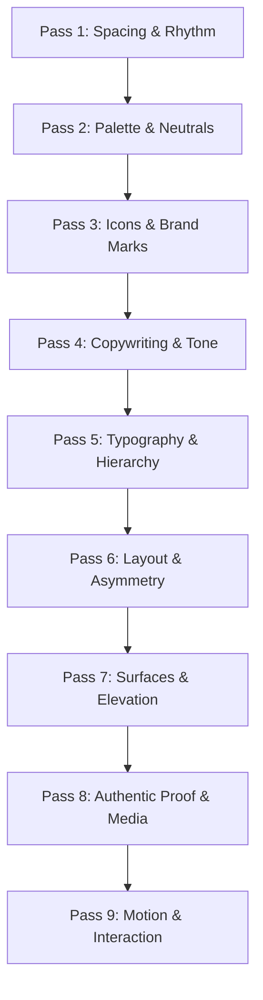

# No Slop Anymore (Anti-Slop Craft Standard)

*Created by Bran ([heybran.my.id](https://heybran.my.id) / [@BranProHengker](https://github.com/BranProHengker))*

The No-Slop Craft Standard is a forensic audit and unslopping system distilled from real-world AI generator tells. AI models, templates, and one-shot builders (v0, Lovable, Bolt, Cursor/Claude vibecoding) fail in remarkably consistent, predictable patterns:

- Every surface glows or blurs;
- Headings are written by a marketing committee with buzzwords and superlatives;
- UI labels are prefixed with `// ` or forced into `UPPERCASE TRACKED` to pretend to be terminal hacker code;
- Buttons pulse desperately begging for clicks, while cards bounce on hover with `scale-105`;
- Color palettes default to stock Tailwind indigo (`#6366f1`) + neon pink (`#ec4899`);
- Spacing is cramped and rhythm is non-existent.

**Unslopping is not stripping down a page into boring plain text.** Real craft keeps the chrome quiet, establishes deliberate typographic contrast, and puts richness into one or two authentic focal moments (a high-fidelity product capture, interactive canvas, or domain-specific data visualization).

---

## 1. The Core Anti-Slop Laws

### Law I: Quiet Chrome, Loud Product
Chrome (navbars, headers, cards, status bars, footer links) must remain quiet, calm, and neutral. Never spread glowing gradients or rainbow accents across backgrounds, borders, or buttons. Richness belongs 100% inside the actual product output or content.

### Law II: Literal Copy Over Marketing Fluff
State literally what the product does, what inputs it takes, and what output it produces. Eliminate adjectives of scale (*"seamless"*, *"elevate"*, *"supercharge"*, *"next-generation"*).

### Law III: No Pseudo-Code Decoration
Never prefix UI text, badges, or section eyebrows with `// ` (e.g. `// 162 INTERFACE ANIMATIONS` or `// 01 HERO`) to fake a hacker/developer vibe. Code belongs in terminal/editor widgets; UI labels belong in clean editorial typography.

### Law IV: Calm Motion Over Wallpaper Animations
Static content must render immediately. Ban delayed staggered scroll-reveal animations (`reveal-on-scroll`), pulsing CTA buttons (`animate-pulse`), and bouncy card scale effects (`hover:scale-105`).

---

## 2. Forensic Tell Registry & Immediate Prescriptions

### A. Hard Generator Fingerprints & Scraps
| Tell | Pattern / Signature | Actionable Fix |
| :--- | :--- | :--- |
| **Builder Artifacts** | `data-lov-id`, `data-v0-t`, `bolt-preview`, `create.xyz`, `lovable-tagger` | Strip all generator metadata tags, wrapper attributes, and telemetry scripts. |
| **Starter Titles** | `<title>Vite + React</title>`, `Create Next App`, `My v0 Project` | Replace with specific product name and a concise, non-fluff proposition. |
| **Chatbot Leaks** | *"I hope this helps"*, *"Certainly!"*, *"As an AI language model"* | Scan entire codebase and remove raw LLM chat output residues. |

### B. Copywriting & Tone Tells
| Tell | Pattern / Signature | Actionable Fix |
| :--- | :--- | :--- |
| **Hero Clichés** | *"Unlock the power of..."*, *"Elevate your workflow"*, *"The most advanced AI..."* | State literally what the product does: *"Inspect web pages for AI builder residue and generator boilerplate."* |
| **Buzzword Overdose** | *Seamless, unleash, revolutionize, game-changing, cutting-edge, holistic* | Replace every buzzword with a concrete metric, tangible feature, or active verb. |
| **Sentence Formulas** | *"It's not just a tool, it's a movement"*, *"Design. Build. Ship."* | State the single value proposition directly without theatrical contrasts or staccato triads. |
| **Em Dash Habit** | Multiple `—` dashes in short paragraphs | Replace with simple periods (`.`) or break into direct, active sentences. |
| **Passive CTA Pairs** | *"Get Started"* paired with *"Learn More"* | Use explicit domain action verbs: *"Start Free"*, *"Open Studio"*, *"Audit URL"*. |
| **Hallucinated Brag Stats**| Round numbers with arbitrary plus signs (`10k+`, `99.9%+`) | Provide auditable numbers with verified units and dates, or omit entirely. |
| **Dummy Testimonials** | Five star icons over *"Sarah M., Marketing Director"* | Use verified testimonials with links to authentic public posts or real identities. |
| **Emoji Bullets** | 🚀, ✨, ⚡, 💡, 🎯 as card icons or bullet points | Replace with calibrated SVG vector icons (e.g., `@iconoir/vue` or Lucide). |

### C. Typography & Text Styling Tells
| Tell | Pattern / Signature | Actionable Fix |
| :--- | :--- | :--- |
| **Pseudo-Code Labels** | `// 162 INTERFACE ANIMATIONS`, `// 01 HERO`, `// ARCHITECTURE` | Remove `// ` prefixes completely. Use standard, unpretentious editorial typography. |
| **Bold Everything** | >60% of all headings uniformly forced into `font-bold` / `font-black` | Vary typographic weights: use `font-normal` or `font-medium` for body, and `font-semibold` for large display type. Let size and space carry hierarchy. |
| **Uppercase Tracked Overdose** | `uppercase tracking-wider` or `tracking-widest` on every badge and label | Use Sentence case or Title case with standard tracking for comfortable reading. |
| **Gradient Text Titles** | `bg-clip-text text-transparent bg-gradient-to-r from-purple-500 to-pink-500` | Use crisp, high-contrast solid foreground colors (`zinc-900` / `white`). |
| **Default Developer Fonts** | Untouched `Inter`, `Roboto`, `Poppins`, `Plus Jakarta Sans` | Choose a typeface suited to the product's world (e.g. `Geist`, `Instrument Sans`, `Editorial Serif`). |

### D. Layout, Surfaces & Architecture Tells
| Tell | Pattern / Signature | Actionable Fix |
| :--- | :--- | :--- |
| **Glowing Orbs & Blobs** | `blur-3xl rounded-full bg-indigo-500/20` floating behind cards | Remove blurred background blobs; rely on clean whitespace and surface contrast. |
| **Colored Left Stripe** | `border-l-4 border-indigo-500` on cards or section headers | Remove decorative left stripe; distinguish surfaces via subtle background tint. |
| **Indigo + Neon Palette**| Stock Tailwind `#6366f1` (indigo) + `#ec4899` (pink) | Pick one deliberate accent color tailored to the domain. |
| **Frosted Glass Overdose**| `backdrop-blur-md` stacked across cards, modals, and nav simultaneously | Use clean solid or subtle translucent surfaces without blur stacking. |
| **Status Dot Badges** | Green glowing dot pill (`"System Online"` / `"New"`) above hero | Remove decorative capsules; integrate announcements directly into headline copy. |
| **Uniform Bento Monotony**| Identical 3-column or 4-column card mosaics with icon + title + paragraph | Break uniform grids with asymmetric compositions, direct interactive demos, or live previews. |
| **Dot Matrix / Grid BG** | Repeating `radial-gradient(1px)` dot grid or blueprint lines | Use a calm solid canvas with hairline borders (`border-zinc-200 dark:border-zinc-800`). |
| **Mock Terminal Window** | Mock Mac terminal with red/yellow/green traffic dots and static shell text | Replace with real copyable code blocks or functional interactive playgrounds. |
| **Forced 3-Step Workflow**| Process forced into `01 -> 02 -> 03` numbered step circles | Document the real operational workflow rather than an arbitrary 3-step geometry. |
| **Untouched Shadcn Tokens**| Stock HSL/OKLCH values (`222.2 84% 4.9%`) unchanged | Customize border-radius, hairline borders, and primary hues. |

### E. Motion & Interaction Tells
| Tell | Pattern / Signature | Actionable Fix |
| :--- | :--- | :--- |
| **Scroll Reveal Stagger** | Staggered `translateY(20px) + opacity: 0` on every section | Let static content render immediately; avoid delayed entrance curtsies. |
| **Pulsing CTA Buttons** | `animate-pulse` or `animate-ping` on buttons and status pills | Remove pulsing; use calm 150ms hover transitions (`transition-colors duration-150`). |
| **Card Scale / Bounce** | `hover:scale-105`, `hover:scale-110`, `hover:-translate-y-2` | Replace card scaling with subtle border-color or surface background illumination. |
| **Indiscriminate Transition** | `transition-all` on heavy containers and cards | Name specific properties explicitly (`transition-colors`, `transition-transform`). |

### F. Code Comment Hygiene
| Tell | Pattern / Signature | Actionable Fix |
| :--- | :--- | :--- |
| **ASCII Banners** | `// ========================== //` or `/* ******* */` | Strip multi-line decorative dividers completely. |
| **Echo Comments** | `// initialize state` above `const state = ref(null)` | Delete comments that merely narrate self-explanatory code syntax. |
| **Rule of Brevity** | Verbose paragraph comments explaining obvious code | Keep comments strictly minimal (5–7 words maximum) only for non-obvious logic. |

---

## 3. The 9-Pass Redline Protocol

When unslopping an existing interface or building a new screen, execute these 9 sequential passes:



### Pass 1: Spacing & Rhythm
- Establish calm whitespace: double the margin between unrelated sections (`space-y-12` or `space-y-16`).
- Group related items tightly (`gap-2` to `gap-3`).
- Ban cramped narrow containers on large viewports; utilize full fluid width with disciplined padding.

### Pass 2: Palette & Neutrals
- Eliminate gradient text and rainbow borders.
- Adopt a single domain-calibrated accent hue (e.g. amber for terminal/tools, emerald for audit/security, deep blue for data).
- Use warm/cool tinted dark neutrals (`#161617`, `#212124`) rather than harsh pure `#000000` or washed-out gray.

### Pass 3: Icons & Brand Marks
- Remove all decorative emojis used as bullets or icons.
- Replace with consistent 20px / 24px SVG vector icons with uniform stroke width (`1.5px` or `2px`).
- Use authentic platform SVG vectors for third-party brands (GitHub, Google, TikTok, Discord), never generic approximations.

### Pass 4: Copywriting & Tone
- Rewrite headlines to describe literal utility.
- Replace *"Seamlessly transform your workflow"* with *"Merge, compress, and convert assets client-side."*
- Eliminate buzzwords, fake 5-star ratings, and staccato 3-word slogans.
- Change CTA buttons from *"Get Started"* to specific verbs (*"Start Auditing"*, *"Export Code"*).

### Pass 5: Typography & Hierarchy
- Remove all `// ` pseudo-code comment prefixes from titles and badges.
- Replace uniform `font-bold` with calibrated weight variation:
  - Display Title: `font-semibold` or `font-bold`, large tracking-tight.
  - Subtitle / Eyebrow: `font-normal` or `font-medium`, Sentence case.
  - Body: `font-normal text-sm leading-relaxed text-[var(--text-secondary)]`.
- Remove forced `uppercase tracking-widest` from badges and navigation.

### Pass 6: Layout & Asymmetry
- Break identical 3-box or 4-box card grids.
- Introduce intentional asymmetry: 60/40 splits, real UI preview frames, interactive code blocks, or side-by-side comparisons.
- Remove fake Mac terminal controls unless the tool is an actual interactive shell emulator.

### Pass 7: Surfaces & Elevation
- Replace glowing blurred blobs with hairline borders (`1px solid var(--border-card)`).
- Use disciplined border radii: `rounded-lg` (8px) for buttons/inputs, `rounded-xl` (12px) for cards, `rounded-full` for status tags.
- Remove backdrop blur overdose; keep backgrounds solid or gently elevated.

### Pass 8: Authentic Proof & Media
- Strip stock photos (Unsplash handshakes, fake AI avatar faces).
- Display real interactive product views, authentic UI screenshots, or verifiable metrics with source links and timestamps.

### Pass 9: Motion & Interaction
- Remove `reveal-on-scroll` delays; allow instant rendering.
- Remove `animate-pulse` from buttons.
- Replace `hover:scale-105` with clean hairline border color shifts or subtle background lighting (`transition-colors duration-150`).
- Scope all transitions to specific CSS properties.

---

## 4. Before & After Code Transforms

````carousel
```html
<!-- BEFORE: Heavy AI Slop Hero -->
<div class="relative min-h-screen bg-black flex flex-col items-center justify-center p-6 overflow-hidden">
  <!-- Glowing Blurred Orbs -->
  <div class="absolute w-96 h-96 bg-purple-600/30 rounded-full blur-3xl -top-20 -left-20 animate-pulse"></div>
  <div class="absolute w-96 h-96 bg-pink-600/30 rounded-full blur-3xl -bottom-20 -right-20"></div>

  <!-- Status Pill with Glowing Dot -->
  <div class="inline-flex items-center gap-2 px-3 py-1 rounded-full border border-purple-500/30 bg-purple-500/10 mb-6 backdrop-blur-md">
    <span class="w-2 h-2 rounded-full bg-emerald-400 animate-ping"></span>
    <span class="text-xs uppercase tracking-widest text-purple-300 font-mono">// 01 NEXT-GEN AI PLATFORM</span>
  </div>

  <!-- Gradient Text Boast -->
  <h1 class="text-5xl font-black text-center tracking-tight bg-clip-text text-transparent bg-gradient-to-r from-purple-400 via-pink-400 to-indigo-400 mb-4">
    Unlock the Future of Seamless Intelligence
  </h1>
  <p class="text-zinc-400 text-center max-w-xl text-lg mb-8">
    Empower your workflow with our revolutionary, cutting-edge AI engine — built for modern teams who demand excellence.
  </p>

  <!-- Default Passive Button Pair with Scale -->
  <div class="flex items-center gap-4">
    <button class="px-6 py-3 rounded-2xl bg-gradient-to-r from-purple-600 to-pink-600 text-white font-bold hover:scale-105 transition-all shadow-lg shadow-purple-500/25 animate-pulse">
      Get Started Free →
    </button>
    <button class="px-6 py-3 rounded-2xl border border-zinc-700 text-white hover:bg-zinc-800 transition-all hover:scale-105">
      Learn More
    </button>
  </div>
</div>
```
<!-- slide -->
```html
<!-- AFTER: Unslop Craft Standard -->
<section class="w-full max-w-6xl mx-auto px-4 sm:px-6 py-12 sm:py-20 space-y-8">
  <div class="space-y-4 max-w-2xl">
    <!-- Clean Unpretentious Eyebrow -->
    <div class="flex items-center gap-2 text-xs font-mono text-zinc-400">
      <span>Developer Utilities</span>
      <span>/</span>
      <span class="text-emerald-400">Deterministic Engine</span>
    </div>

    <!-- Solid High-Contrast Typography -->
    <h1 class="text-3xl sm:text-4xl font-bold tracking-tight text-white leading-tight">
      Forensic detector for AI code slop and generator fingerprints.
    </h1>
    <p class="text-sm sm:text-base text-zinc-400 leading-relaxed">
      Audits web pages for stock builder tokens, leaked chatbot residue, and decorative pseudo-code. Provides instant, zero-token markdown fix checklists.
    </p>

    <!-- Specific Action-Driven Controls -->
    <div class="flex flex-wrap items-center gap-3 pt-2">
      <button class="h-10 px-4 rounded-lg bg-white text-zinc-950 font-medium text-xs sm:text-sm hover:bg-zinc-200 transition-colors duration-150 cursor-pointer">
        Audit Live Website
      </button>
      <button class="h-10 px-4 rounded-lg border border-zinc-800 bg-zinc-900/50 text-zinc-300 font-medium text-xs sm:text-sm hover:text-white hover:bg-zinc-800 transition-colors duration-150 cursor-pointer">
        Inspect Screenshot
      </button>
    </div>
  </div>

  <!-- Real Product View / Asymmetrical Surface -->
  <div class="rounded-xl border border-zinc-800 bg-[#161617] p-5 shadow-xs">
    <div class="flex items-center justify-between pb-3 border-b border-zinc-800/80 text-xs font-mono text-zinc-400">
      <span>AUDIT PIPELINE STATUS</span>
      <span class="text-emerald-400 font-medium">100% Client-Side Canvas & AST</span>
    </div>
    <div class="pt-4 grid grid-cols-1 sm:grid-cols-3 gap-4 text-xs font-mono">
      <div class="p-3 rounded-lg bg-zinc-900/60 border border-zinc-800">
        <span class="text-zinc-500 block">Generator Signatures</span>
        <span class="text-emerald-400 text-sm font-semibold">0 Detected</span>
      </div>
      <div class="p-3 rounded-lg bg-zinc-900/60 border border-zinc-800">
        <span class="text-zinc-500 block">Fluff Density</span>
        <span class="text-emerald-400 text-sm font-semibold">0.0 / 1000 words</span>
      </div>
      <div class="p-3 rounded-lg bg-zinc-900/60 border border-zinc-800">
        <span class="text-zinc-500 block">Interaction Motion</span>
        <span class="text-zinc-200 text-sm font-semibold">150ms Solid Easing</span>
      </div>
    </div>
  </div>
</section>
```
````

---

## 5. Verification Checklist

Before publishing code or completing any UI modification, verify against this checklist:

- [ ] **No Pseudo-Code Labels:** Zero headings or badges prefixed with `// ` or pseudo-code commentary.
- [ ] **No Glowing Background Blobs:** Zero blurred orbs (`blur-2xl`, `blur-3xl`) or neon divider lines.
- [ ] **No Gradient Text:** Headlines use crisp solid colors (`zinc-900` / `white`), never `bg-clip-text`.
- [ ] **No Emoji Bullets:** Zero emojis used as icons or bullet markers.
- [ ] **No Pulsing Buttons:** Zero `animate-pulse` or `animate-ping` on buttons and cards.
- [ ] **No Bouncy Scale:** Zero `hover:scale-105` or `hover:scale-110` on static cards.
- [ ] **Explicit Transitions:** Zero indiscriminate `transition-all`; target properties named explicitly.
- [ ] **No Marketing Fluff:** Zero instances of *"seamless"*, *"elevate"*, *"supercharge"*, or *"not just X"*.
- [ ] **Concrete Buttons:** Primary actions named with specific verbs, not *"Get Started / Learn More"*.
- [ ] **Clean Code Comments:** Zero multi-line ASCII divider banners (`// ======` or `/* ***** */`).
